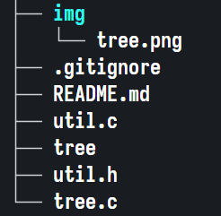

<p align="center">
    <b><i>tree.c</i></b>
</p>

<p align="center">
    
</p>

___

Just a `tree` command implementation in C

**Compile:**
```sh
$ cc tree.c util.c -o tree
```

**Run:**
```sh
$ ./tree [DIRECTORY]
```
